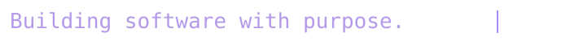

### Building things that make sense — and make a difference.

  

## ✦ Hi, I'm Eya

I like building at the intersection of **software engineering, data and real-world impact**. My path began with a curiosity for the stories hidden in data; these days, I'm just as interested in turning those insights into useful applications.

I'm in my **second year of Software Engineering at ESPRIT**, bringing a **Business Intelligence** background into everything I build: from interfaces and APIs to dashboards and intelligent systems.

> 💜 My favorite projects combine a clear purpose, thoughtful design, and solid engineering.

`🇹🇳 Tunisia` · `💻 Software engineering` · `📊 Data mindset` · `✨ Always experimenting`

## ✦ Selected work

### 🏫 Spotli
**A smarter way to share campus spaces.**

Exploring a service-oriented university space booking platform, connecting rooms, availability, equipment and reservations through a microservices approach.

`Spring Boot` `REST APIs` `Microservices`

### 📊 CRMN Dashboard
**Making complex data feel clear.**

Built a real-time dashboard experience that helps teams see performance indicators in one place and make better-informed decisions.

`React` `Node.js` `MySQL` `Power BI` `Talend`

### 🚗 [AUTOLOC](https://github.com/eyabenhassyne/AUTOLOC)
**Backend systems, built with intention.**

Working with a car-rental domain to explore RESTful design, relational modeling and layered backend architecture.

`Java` `Spring Boot` `JPA` `MySQL`

### 🌱 [WasteWise TN](https://github.com/eyabenhassyne/Esprit-PIDEV-3A55-2526-WasteWiseTn)
**A little more tech for a greener world.**

A web and desktop platform for understanding waste-management activity through practical tools and visual indicators.

`Symfony` `JavaFX`

### 🏭 Industrial Training Simulation
**Learning by stepping inside the experience.**

Exploring interactive industrial training in Unity: bringing software, 3D environments and practical learning together.

`Unity` `3D interaction` `Simulation`

## ✦ My toolkit

**Building applications**

      

`C` · `Node.js` · `JavaFX`

**Working with data**

    

`SQLite` · `NumPy` · `Talend`

**Creating &amp; collaborating**

   

`Postman` · `FlutterFlow`

## ✦ The story behind the code

### 🔮 An analytical foundation

Studying **Business Intelligence** taught me to look beyond numbers and ask the right questions. At **ESPRIT**, I'm extending that mindset into designing, developing and connecting software systems.

### ⚡ Experience that shaped my thinking

Building BI dashboards at **CRMN** and exploring data analysis at **Advery Agency** taught me to start with the problem, communicate clearly and make complexity easier to act on.

I also contribute to the **IEEE Tunisia / IEEE ESPRIT** community — a space where I've learned that collaboration, initiative and curiosity matter just as much as code.

## ✦ More than commits

Explore what I’m building through my **[repositories](https://github.com/eyabenhassyne?tab=repositories)** and **[recent activity](https://github.com/eyabenhassyne?tab=overview)**. My live contribution calendar is right here on GitHub.

---

### ✨ Let's build something meaningful.

I'm always happy to connect about **software, data, creative projects or a new idea worth exploring**.

**[Find me on LinkedIn](https://www.linkedin.com/in/eya-ben-hassyne/) · [Say hello by email](mailto:benhassine.eya@esprit.tn)**

